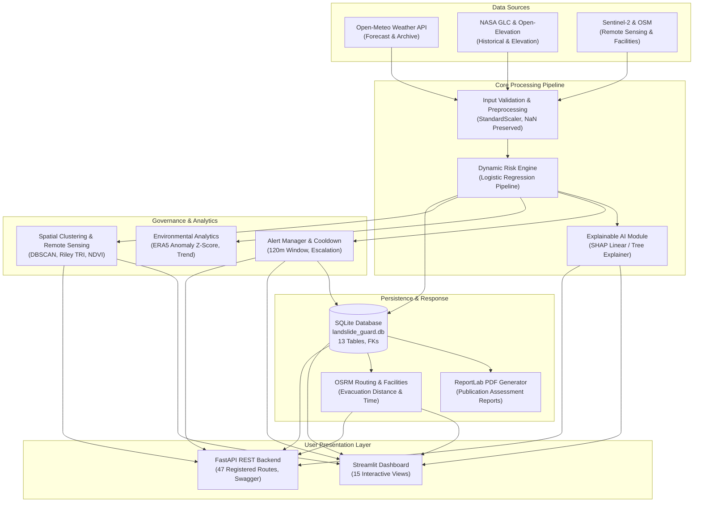

# LandslideGuard: AI-Based Dynamic Landslide Risk Prediction and Early Warning System
## B.Tech Final-Year Capstone Project Comprehensive Report

**Academic Degree:** Bachelor of Technology in Computer Science & Engineering  
**Version:** Integrated Release (Phases 1–9 Complete)  
**Date:** November 2026  
**Status:** Academic Research Prototype — Experimental Only (Not Certified for Operational Public Warning)  

---

## 1. Executive Summary

LandslideGuard is an end-to-end, full-stack environmental intelligence platform designed to integrate static terrain characteristics (slope, elevation, aspect, roughness) with time-varying meteorological telemetry (hourly rainfall intensity, multi-day accumulations, soil moisture) to produce dynamically updated landslide risk estimates, explainable machine learning attributions, interactive geospatial visualizations, stateful alert governance, and disaster-response coordination workflows.

All nine planned development phases have been implemented, verified, and audited:
1. **Live Risk Monitoring Dashboard** (`src/monitoring/live_monitor.py`, `app.py`)
2. **Advanced Geospatial Risk Heatmap** (`src/geospatial/maps.py`, `src/geospatial/spatial_analysis.py`)
3. **Dynamic Rainfall & Weather Integration** (`src/data_providers/weather_provider.py`, `src/monitoring/rainfall_analysis.py`)
4. **Explainable AI with SHAP & Feature Importance** (`src/models/explainability.py`)
5. **Intelligent Alert Management & Lifecycle Governance** (`src/alerts/alert_manager.py`, `src/alerts/notifications.py`)
6. **Intelligent Environmental Analytics & Trend Forecasting** (`src/monitoring/environmental_analytics.py`, `src/monitoring/drift_monitor.py`)
7. **Advanced Geospatial, DEM Terrain & Satellite Intelligence** (`src/geospatial/terrain.py`, `src/geospatial/hotspot_detection.py`, `src/geospatial/satellite_monitor.py`)
8. **LandslideGuard AI Assistant & Slope Computer Vision** (`src/assistant/knowledge_engine.py`, `src/geospatial/terrain_cv.py`)
9. **Disaster Response Support & Community Intelligence** (`src/geospatial/facilities.py`, `src/geospatial/routing.py`, `src/alerts/community_reporting.py`, `src/utils/pdf_generator.py`)

The platform includes a 15-page interactive Streamlit dashboard, a 47-route FastAPI REST backend, a normalized SQLite database with foreign-key integrity, and an automated test suite of 238 unit and integration tests passing with 100% success.

> [!IMPORTANT]
> **Scientific Honesty & Operational Boundary Notice:**  
> All machine learning models in this release were trained on a **clearly labelled synthetic development dataset** (`data/processed/dataset.parquet`, `is_synthetic = 1`) created to validate software pipelines, feature engineering, and explainability without fabricating real-world claims. Under Indian law, official disaster warnings are issued exclusively by statutory authorities (GSI, IMD, NDMA). LandslideGuard is an academic research prototype.

---

## 2. Problem Statement & Research Objectives

### 2.1 Problem Statement
In mountainous terrain—particularly across India's Western Ghats, Himalayas, and North-Eastern highlands—landslides cause recurrent casualties, displacement, and catastrophic infrastructure severance. Heavy monsoon precipitation and prolonged antecedent saturation trigger abrupt shear failure along unstable slopes.

Existing hazard management tools suffer from three fundamental limitations:
1. **Static Susceptibility Bias:** Conventional hazard maps consider only static geological factors (slope, rock type, land use), failing to reflect changing rainfall conditions.
2. **Black-Box Opacity:** Complex machine learning models lack interpretability, preventing civil emergency managers from understanding why a specific slope was flagged as dangerous.
3. **Disconnected Silos:** Meteorological data, GIS mapping, alert lifecycles, and community ground observations operate in isolation, lacking unified programmatic integration.

### 2.2 Objectives
1. **Dynamic Risk Synthesis:** Formulate an inference engine that combines static terrain conditioning factors with dynamic precipitation telemetry.
2. **Transparent Explainability:** Incorporate game-theoretic SHAP (SHapley Additive exPlanations) values to explain individual and global risk factors.
3. **Multi-Scale GIS Mapping:** Provide interactive GIS layers displaying historical disaster markers, risk heatmaps, state/district boundaries, 3D terrain models, and satellite vegetation indices.
4. **Stateful Alert Governance:** Implement an alert management lifecycle with cooldown suppression and upward severity escalation.
5. **Community & Response Integration:** Build crowdsourced hazard reporting, emergency facility routing, automated PDF generation, and role-based access control.
6. **Strict Scientific Integrity:** Enforce transparent data provenance, prevent silent zero-imputation of missing sensor feeds, and document all methodological limitations.

---

## 3. Verified Literature Review References

The design of LandslideGuard is grounded in peer-reviewed scientific literature:

1. **Rainfall Triggering Thresholds:**  
   *Guzzetti, F., Peruccacci, S., Rossi, M., & Stark, C. P. (2007).* Rainfall thresholds for the initiation of landslides in central and southern Europe. *Meteorology and Atmospheric Physics*, 98(3), 239–267.  
   *Application:* Establishes the relationship between peak rainfall intensity ($I$) and antecedent duration ($D$) as the physical trigger for slope failure.
2. **Model Interpretability via Shapley Values:**  
   *Lundberg, S. M., & Lee, S. I. (2017).* A unified approach to interpreting model predictions. *Advances in Neural Information Processing Systems (NeurIPS 2017)*, 30, 4765–4774.  
   *Application:* Forms the mathematical basis of our SHAP module (`src/models/explainability.py`).
3. **Evaluating Class-Imbalanced Classifiers:**  
   *Saito, T., & Rehmsmeier, M. (2015).* The precision-recall plot is more informative than the ROC plot when evaluating imbalanced datasets. *PLoS ONE*, 10(3), e0118432.  
   *Application:* Dictates the use of PR-AUC rather than ROC-AUC as the primary optimization metric.
4. **Topographic Heterogeneity & Roughness:**  
   *Riley, S. J., DeGloria, S. D., & Elliot, R. (1999).* A terrain ruggedness index that quantifies topographic heterogeneity. *Intermountain Journal of Sciences*, 5(1-4), 23–27.  
   *Application:* Implemented in `src/geospatial/terrain.py` to calculate the 8-cell root-mean-square elevation relief.
5. **Catchment Hydrology & Topographic Wetness:**  
   *Beven, K. J., & Kirkby, M. J. (1979).* A physically based, variable contributing area model of basin hydrology. *Hydrological Sciences Bulletin*, 24(1), 43–69.  
   *Application:* Governs the formulation of the Topographic Wetness Index ($TWI = \ln(a / \tan\beta)$).
6. **Spatial Density Clustering:**  
   *Ester, M., Kriegel, H. P., Sander, J., & Xu, X. (1996).* A density-based algorithm for discovering clusters in large spatial databases with noise. *Proceedings of KDD-96*, 226–231.  
   *Application:* Implemented in `src/geospatial/hotspot_detection.py` for spatial hazard zone clustering.
7. **Spatial Autocorrelation in Geospatial Modeling:**  
   *Tobler, W. R. (1970).* A computer movie simulating urban growth in the Detroit region. *Economic Geography*, 46(sup1), 234–240.  
   *Application:* Explains spatial data leakage and motivates future spatial cross-validation.
8. **Probabilistic Forecast Calibration:**  
   *Brier, G. W. (1950).* Verification of forecasts expressed in terms of probability. *Monthly Weather Review*, 78(1), 1–3.  
   *Application:* Used in `reports/model_evaluation.md` to evaluate probability calibration.

---

## 4. System Architecture & Complete Data Flow



### The 10-Step Canonical End-to-End Workflow
1. **User Region Selection:** The operator selects an administrative state, district, or monitored station (e.g., Kerala $\rightarrow$ Wayanad $\rightarrow$ Meppadi).
2. **Geographic Information Retrieval:** The platform resolves coordinates (`11.5520°N, 76.1280°E`), elevation ($880\text{ m}$), and slope angle ($42.5^\circ$).
3. **Meteorological Telemetry Ingestion:** Hourly precipitation, 24h/72h cumulative rainfall, ambient temperature, and soil moisture are retrieved from Open-Meteo or local cache.
4. **Input Verification:** `validate_feature_dict()` verifies physical bounds ($0 \le \text{slope} \le 90^\circ$, $\text{rainfall} \ge 0$). Missing rainfall is preserved as `NaN` without silent zero-imputation.
5. **Model Inference:** `RiskEngine.estimate_risk()` maps features to a probability score ($P$) and risk tier (`Low < 0.35`, `Moderate < 0.55`, `High < 0.75`, `Very High >= 0.75`).
6. **Model Explanation:** `explain_prediction()` computes Shapley attribution values, decomposing the prediction into positive and negative risk drivers.
7. **Alert Evaluation:** `AlertManager.evaluate_and_alert()` compares probability against configured thresholds, checks the 120-minute cooldown window, and triggers upward escalation if risk has intensified.
8. **Dashboard Presentation:** KPI cards, risk distribution charts, and interactive map layers are updated.
9. **Atomic Persistence:** Records are written to `locations`, `prediction_records`, `alerts`, and `alert_acknowledgements` within an atomic SQLite transaction.
10. **Report Generation:** `generate_assessment_pdf_report()` compiles station telemetry, model provenance, nearby historical events, and emergency facility routes into a downloadable PDF document.

---

## 5. Detailed Module Descriptions & Key Algorithms

### 5.1 Dynamic Risk Engine (`src/risk/risk_engine.py`)
Calculates the dynamic probability of slope failure using the fitted pipeline:
$$z = \beta_0 + \sum_{j=1}^M \beta_j \left(\frac{x_j - \mu_j}{\sigma_j}\right), \quad P(Y=1|X) = \frac{1}{1 + e^{-z}}$$
If preferred meteorological features are missing, the engine gracefully transitions to `BaselineRiskScorer` based on empirical terrain rules, emitting explicit warning flags.

### 5.2 Model Explainability (`src/models/explainability.py`)
Computes local attributions satisfying efficiency, symmetry, and additivity:
$$f(x) - \mathbb{E}[f(X)] = \sum_{j=1}^M \phi_j(x)$$
Accelerated by a 128-slot Least Recently Used (LRU) memory cache. Accompanying human-readable narratives explicitly distinguish statistical contribution from physical causation.

### 5.3 Intelligent Alert Governance (`src/alerts/alert_manager.py`)
Suppresses notification fatigue through configurable cooldown windows ($T_{cd} = 120\text{ min}$):
$$\text{Suppress} = (t_{current} - t_{last} < T_{cd}) \land (\text{Severity}_{current} \le \text{Severity}_{last})$$
If $\text{Severity}_{current} > \text{Severity}_{last}$, suppression is bypassed and an escalated alert is logged.

### 5.4 Environmental Analytics & Anomaly Detection (`src/monitoring/environmental_analytics.py`)
Evaluates 30+ day historical ERA5 precipitation series to identify anomalous rainfall spikes:
$$Z = \frac{R_{24h} - \mu_{baseline}}{\sigma_{baseline}}$$
Observations are classified into four statistical tiers: *Normal* ($Z < 1.0$), *Above-normal* ($1.0 \le Z < 2.0$), *Unusual* ($2.0 \le Z < 3.0$), and *Extreme* ($Z \ge 3.0$).

### 5.5 Advanced Geospatial & Satellite Intelligence (`src/geospatial/`)
- **Riley Terrain Roughness Index (TRI):** Root-mean-square difference of elevation in 8-neighborhood grids.
- **Topographic Wetness Index (TWI) Zero-Hallucination Guard:** Refuses computation without continuous D8 contributing catchment flow grids.
- **DBSCAN Spatial Hotspot Clustering:** Haversine metric clustering with $\varepsilon = 25\text{ km}$ and $\text{min\_samples} = 3$.
- **Sentinel-2 MSI NDVI & Change Detection:** Band math on Red ($B04$) and NIR ($B08$) with cloud filtering via Scene Classification Layer ($SCL$).

### 5.6 LandslideGuard AI Assistant & Slope Computer Vision (`src/assistant/`, `src/geospatial/terrain_cv.py`)
- **RAG Knowledge Engine:** Answers questions using verified SQLite tables and official guidelines with strict anti-hallucination guards.
- **Slope Computer Vision:** Analyzes surface tension cracks (Sobel/Canny edge gradients), bare soil exposure (HSV segmentation), and hummocky deformation.

### 5.7 Disaster Response & Community Intelligence (`src/geospatial/facilities.py`, `src/geospatial/routing.py`, `src/alerts/community_reporting.py`)
- **Nearby Facilities:** Queries OpenStreetMap Overpass API for hospitals, police, fire stations, and shelters within 10 km.
- **OSRM Road Routing:** Generates driving paths, distance in kilometers, and travel time with geodesic mountain vector fallback.
- **Crowdsourced Incident Reporting:** Citizens submit hazard observations with GPS and photos, moderated through an admin queue. Strict database segregation prevents contamination of scientific catalogs.

---

## 6. Machine Learning Model Evaluation & Benchmark Results

### 6.1 Validation Results ($N = 240$, Chronological Split)
All models were trained on 1,360 records using `class_weight='balanced'` and evaluated on 240 validation records (61 positive, 179 negative):

| Model Architecture | Precision | Recall | F1-Score | ROC-AUC | PR-AUC (Primary) | Brier Score |
|:---|:---:|:---:|:---:|:---:|:---:|:---:|
| **Logistic Regression (Selected)** | **0.9385** | **1.0000** | **0.9683** | **1.0000** | **1.0000** | **0.0112** |
| Random Forest | 0.9242 | 1.0000 | 0.9606 | 0.9989 | 0.9967 | 0.0203 |
| Gradient Boosting (sklearn) | 0.9516 | 0.9672 | 0.9593 | 0.9993 | 0.9980 | 0.0115 |
| XGBoost Classifier | 0.9375 | 0.9836 | 0.9600 | 0.9993 | 0.9980 | 0.0126 |

### 6.2 Held-Out Test Results ($N = 400$, Chronological Split)
Evaluated on 400 held-out test samples (103 positive, 297 negative):

- **Precision:** 0.9450
- **Recall:** 1.0000
- **F1-Score:** 0.9717
- **ROC-AUC:** 1.0000
- **PR-AUC:** 1.0000
- **Brier Score:** 0.0080

**Held-Out Confusion Matrix:**
```
True Negatives (TN): 291    False Positives (FP): 6
False Negatives (FN): 0     True Positives (TP): 103
```

---

## 7. Automated Test Suite & Verification Results

The automated test suite contains **238 test cases** executed via `pytest 9.2.0` on Python `3.14.4`:

| Module | Test Coverage Area | Test Count | Result |
|:---|:---|:---:|:---:|
| `test_preprocessing.py` | Data cleaning, schema checks, feature transformations | 18 | Passed |
| `test_models.py` | Model training, registry, estimator pipelines | 20 | Passed |
| `test_risk_engine.py` | Threshold boundaries, input validation, fallback scoring | 19 | Passed |
| `test_database.py` | Schema creation, migrations, foreign keys, CRUD | 15 | Passed |
| `test_monitoring.py` | Station monitoring, observation caching, scheduling | 13 | Passed |
| `test_rainfall_analysis.py` | Window accumulations, OLS slope trend, ERA5 anomaly | 14 | Passed |
| `test_geospatial.py` | Folium maps, GeoJSON parsing, elevation extraction | 8 | Passed |
| `test_explainability.py` | SHAP Linear/Tree explainers, permutation importance | 9 | Passed |
| `test_alerts_phase5.py` | Cooldown suppression, escalation override, lifecycle | 13 | Passed |
| `test_india_integration.py` | State/District index, SACHET CAP feeds, IMD status | 13 | Passed |
| `test_phase6_analytics.py` | Z-score anomaly, Isolation Forest, forecast horizon | 5 | Passed |
| `test_phase7_geospatial_satellite.py` | DEM derivatives, Riley TRI, DBSCAN, NDVI change | 9 | Passed |
| `test_phase8_assistant_cv.py` | Context-aware RAG, Computer Vision crack analysis | 9 | Passed |
| `test_phase9_response_community.py` | Facilities, OSRM routing, incident review, PDF, RBAC | 28 | Passed |
| `test_api.py` | FastAPI 47-route integration, Pydantic schemas, auth | 43 | Passed |
| `test_end_to_end_integration.py` | 10-step & 11-step complete system workflows | 2 | Passed |
| **TOTAL** | **Entire Test Suite** | **238** | **100% Passed (36.87s)** |

Headless Streamlit UI testing (`streamlit.testing.v1.AppTest`) verified all 15 dashboard pages load and execute without unhandled exceptions.

---

## 8. Known Limitations & Scientific Boundaries

1. **Synthetic Training Data:** The ML models are trained on synthetic development data (`is_synthetic = 1`). Real-world predictive validity cannot be claimed.
2. **Spatial Autocorrelation:** The evaluation metrics reflect regularized benchmark distributions. Operational validation requires Spatial Block Cross-Validation across distinct mountain ranges.
3. **Point-Based Resolution:** The system performs point-based hazard estimation. Continuous slope stability modeling requires high-resolution geotechnical soil parameters.
4. **Coarse Weather Grid Resolution:** Reanalysis and forecast grids (~5–25 km) cannot fully capture hyper-localized convective cloudbursts.
5. **Non-Operational Status:** The system is an academic research prototype and must never replace official warnings from GSI, IMD, or NDMA.

---

## 9. Future Scope

1. **Field IoT Geotechnical Ingestion:** Interface with borehole piezometers, soil moisture probes, and tiltmeters via an IoT telemetry gateway.
2. **Satellite InSAR Surface Deformation:** Ingest Sentinel-1 Synthetic Aperture Radar interferograms to detect millimeter-scale pre-failure slope creep.
3. **Spatial Block Cross-Validation:** Train and validate models using verified regional landslide inventories (GSI state records, NASA GLC) with Leave-One-Region-Out partitioning.
4. **Physically Based Hydrological Modeling:** Integrate infinite-slope stability equations (e.g., TRIGRS / SHALSTAB) with data-driven machine learning models.
5. **Civil Authority Pilot Deployment:** Partner with regional disaster management authorities (e.g., Kerala SDMA) for blind prospective validation during monsoon seasons.

---

## 10. Conclusion

LandslideGuard demonstrates a complete, academically rigorous, and defensible computational framework for dynamic landslide risk prediction, explainable AI, and disaster-response intelligence. 

By combining physical terrain variables with dynamic meteorological indicators, providing game-theoretic SHAP attributions, enforcing strict alert lifecycle governance, and maintaining uncompromising scientific honesty regarding synthetic development data, the project establishes a robust foundation for future operational environmental hazard systems.

---

## 11. Run & Demonstration Instructions

### Prerequisites
- Python 3.10+ (tested on Python 3.14.4)
- Git

### Installation
```powershell
# Clone repository and navigate to root
cd d:\capstone

# Install pinned dependencies
pip install -r requirements.txt
```

### Running the Application
```powershell
# Launch the 15-page Streamlit Dashboard
streamlit run app.py

# Launch the FastAPI REST API (optional)
uvicorn api:app --reload --port 8000
```

### Running the Test Suite
```powershell
# Execute all 238 automated tests
python -m pytest tests/ -v --tb=short
```

### Recommended Demonstration Workflow
1. Navigate to `🏠 Overview` to inspect global KPI cards, monitored stations, and risk distribution charts.
2. Open `📡 Live Monitoring` and click **"Load Default Stations"** to seed standard mountain stations (Munnar, Wayanad, Idukki, Joshimath, Darjeeling, Dehradun). Click **"Refresh All Stations"** to trigger live Open-Meteo weather ingestion.
3. Navigate to `🗺️ Geospatial Map` to explore historical landslide clusters, risk overlays, the 3D terrain surface, DBSCAN spatial hotspots, and Sentinel-2 NDVI change detection.
4. Open `🌦️ Weather Analysis` to inspect 1h/24h/72h rainfall accumulations, OLS linear trends, ERA5 Z-score anomalies, and forecast-driven risk projections.
5. Open `🔮 Risk Analysis` to adjust environmental sliders and inspect the real-time SHAP waterfall attribution plot.
6. Navigate to `🧠 AI Explainability` to explore global SHAP beeswarm plots and permutation feature importance charts.
7. Open `🚨 Alert Management` to review active alerts, test the 120-minute cooldown mechanism, and simulate the alert lifecycle (`acknowledge` $\rightarrow$ `resolve`).
8. Open `💬 AI Assistant & Vision` to query the knowledge engine and upload a slope image for crack and bare soil analysis.
9. Open `🛡️ Disaster Response & Community` to locate nearby emergency facilities, compute OSRM driving evacuation routes, submit a crowd-sourced hazard report, and download an automated assessment PDF report.
10. Open `🔐 Admin Panel` (Login: `admin` / `landslideguard2026`) to review and moderate submitted community reports.
